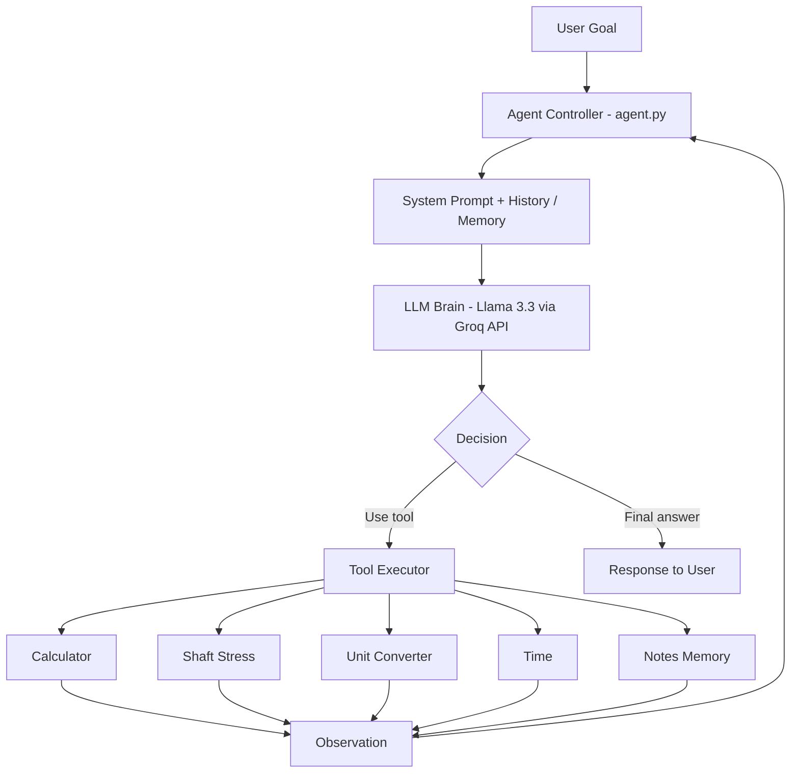
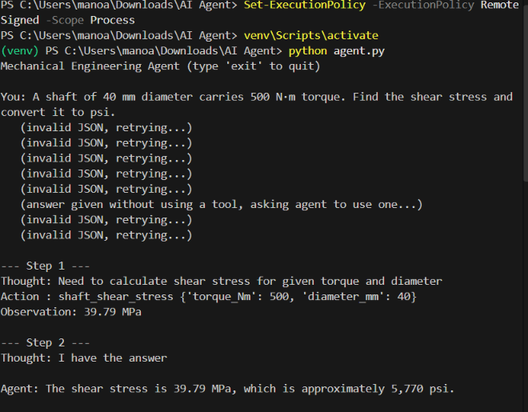
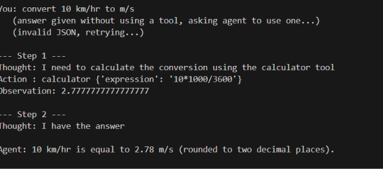

# Mechanical Engineering Assistant Agent

**Name:** Aishwaryan Manoharan | **Reg. No:** 23BME1180 | **Course:** [Artificial Intelligence]

## What it is
An agentic AI agent that solves mechanical engineering tasks step by step.
It reasons about the goal, chooses a tool, observes the result, and repeats
until it can give a final answer (the ReAct loop: Reason, Act, Observe).

## Architecture (schema)

## Components
| Part | Implementation |
|---|---|
| Brain (LLM) | GPT-OSS 120B via Groq API |
| Tools | calculator, shaft_shear_stress, unit_convert, current_time, save_note, read_notes |
| Memory | Conversation history (short-term) and notes.txt (long-term) |
| Control loop | `run_agent()` in agent.py, with a maximum of 6 steps |

## Safety and reliability features
- Safe calculator (no eval)
- Maximum step limit to prevent infinite loops
- JSON format validation with automatic retry
- Guard that forces tool use for calculations

## Setup
1. Install Python 3.9 or higher
2. `python -m venv venv` then `venv\Scripts\activate`
3. `pip install -r requirements.txt`
4. Copy `.env.example` to `.env` and add your own Groq API key
5. `python agent.py`

## Example runs

